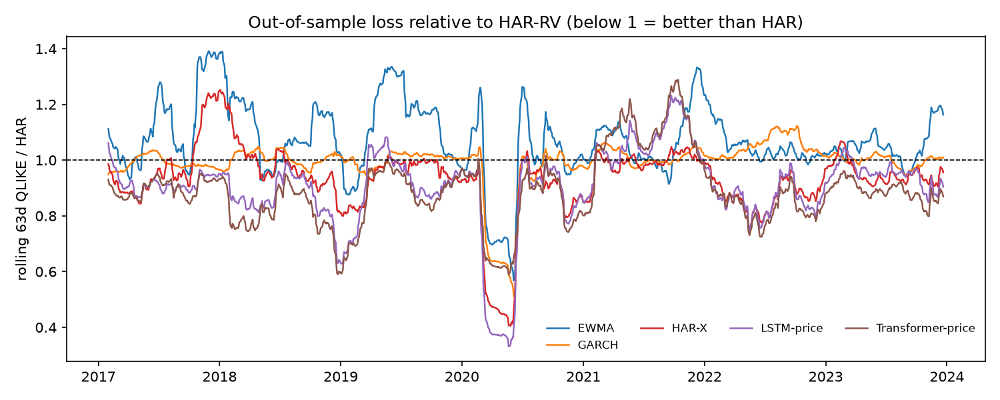

# Volatility forecasting with news sentiment

**Result (2017–2023 walk-forward, 30 large caps, price features only):** both deep models beat HAR-RV on next-week volatility. The LSTM's pooled QLIKE is **0.495 ± 0.004 vs 0.576** (3 seeds; Diebold–Mariano p = 0.002), and the LSTM and Transformer are the only models in the 90% Model Confidence Set. However, a *linear* HAR on the same inputs (HAR-X, 0.511) recovers about 80% of the gain. Against HAR-X, the LSTM's remaining edge is small but significant (p = 0.002), and the Transformer's is not (p = 0.078). The news-sentiment experiments (V3/V4) need the FNSPID + GPU stage on RunPod; see [Status](#status).



## How to run (3 commands)

```bash
pip install -r requirements.txt
bash scripts/run_all.sh          # tests -> data -> sentiment -> V1..V6 -> eval -> benchmark -> pipeline
streamlit run dashboard/app.py
```

Individual stages are `make data | news | sentiment | panel | baselines | deep | ablation | eval | test | bench | daily | dashboard`. Every run starts from a YAML file in `configs/`. Override any key with `--set key=value`, and use `--smoke` for a 1-fold, 1-seed, 2-epoch check.

## Question

Does daily news sentiment, added to an LSTM or Transformer, improve **5-day realized-volatility** forecasts over strong econometric baselines? And in which regimes (calm vs. stressed)? The project forecasts volatility, not returns.

## Data

| Dataset | Use | License |
|---|---|---|
| yfinance | Adjusted daily OHLCV for the universe, ^GSPC and ^VIX, 2009–2023 (2009 is feature warm-up only) | Apache-2.0 library; Yahoo data for personal/research use |
| [takala/financial_phrasebank](https://huggingface.co/datasets/takala/financial_phrasebank) | `sentences_allagree` and `sentences_75agree`, used to train and evaluate the sentiment model | CC BY-NC-SA 3.0 |
| [FNSPID](https://huggingface.co/datasets/Zihan1004/FNSPID) | Headlines with date and ticker, from both `nasdaq_exteral_data.csv` and `All_external.csv` | CC BY 4.0 |

No raw data is committed (`data/` is in `.gitignore`). `make data` caches prices as Parquet. `make news` downloads FNSPID (~29 GB) and keeps only the universe headlines.

**Universe rule** (fixed before any modelling, in `configs/universe.yaml`): walk down the S&P 500 members on 2010-01-01, ranked by end-2009 market cap. Keep a ticker if it has continuous adjusted prices under the same symbol through 2023 **and** at least 20 FNSPID headlines in each study year. Stop at 30. BRK-B is excluded because it joined the index in Feb 2010. Selection decisions are logged in `reports/tables/universe_selection.csv`.

**News alignment** (`src/data/news.py`, tested in `tests/test_news_alignment.py`): FNSPID timestamps are parsed as UTC and converted to New York time. A headline at or after **16:00 ET**, or on a weekend/holiday, counts for the **next** trading day. FNSPID rows stamped `00:00:00` carry a date but no time, and they are most of the file (99% of `All_external.csv`). These are treated as published *after the close*. That can delay a signal by a day but can never leak one. `python -m src.data.news --audit` checks the "UTC" label against session-specific headlines ("Pre-Market", "Mid-Day", "After-Hours").

## Target and features

* **Target:** `RV(t,t+5) = sqrt(Σ_{i=1..5} r²_{t+i})` from daily log returns. Models predict `log RV`.
* **Price features** (data through day *t* only; `tests/test_features.py` perturbs the future and checks that nothing at *t* moves): HAR daily/weekly/monthly RV, Parkinson and Garman–Klass vol (daily and 5-day), |r|, r, 60-day volume z-score, log VIX and its change, day-of-week.
* **Sentiment features:** for each ticker and day, the mean of `p_pos − p_neg`, the log headline count, the max `p_neg`, and a `has_news` flag. Also market-wide mean sentiment and count. All use exponential decay `S_t = x_t + 0.5·S_{t−1}`, so yesterday's news counts a little today.
* **From log forecasts to variance forecasts.** QLIKE needs a variance forecast. For log-space models it is `exp(2ŷ)·smear`, where `smear` is the Duan smearing factor estimated on the fit window (validation year for deep models), never on test data. GARCH and EWMA produce variances natively.

## Models

| Model | Notes |
|---|---|
| EWMA λ=0.94 | RiskMetrics, flat 5-day term structure |
| GARCH(1,1)-t | `arch`, one fit per ticker per walk-forward window. Test forecasts filter through each origin with fixed parameters |
| **HAR-RV** | Per-ticker OLS of log RV on log daily/weekly/monthly RV. **The bar to beat** |
| HAR-X | Same OLS on *all* price features. Not in the original spec; added to separate "better inputs" from "deep model" |
| HAR-RV + sentiment | HAR + the six sentiment features (V4) |
| LSTM | 2 layers, hidden 64, 60-day window, 8-dim ticker embedding, dropout 0.2 |
| Transformer | 3 pre-norm encoder layers, 4 heads, d_model 64, sinusoidal positions, ticker embedding added to each token, read-out at the last token |
| Sentiment | `distilroberta-base` fine-tuned on FinancialPhraseBank (3 classes), compared with `ProsusAI/finbert` |

**Training.** Walk-forward: train 2010–2015, validate 2016, test 2017, then roll forward one year at a time to test 2023 (7 folds). The last 5 days of each train and validation window are **purged**, because their targets overlap the next window. Scalers are fit on training rows only and refit at every step. Deep models use MSE on standardized log RV, Adam 1e-3, batch 256, early stopping on the validation year (patience 5), **3 seeds**, and report mean ± std. Baselines have no hyperparameters, so they are fit on train + val. That gives them an extra, more recent year: the honest direction.

## Results

Pooled over 2017–2023. 52,650 (date, ticker) forecasts, the same rows for every model. DM is Diebold–Mariano vs HAR on the cross-sectional mean loss per date, with Newey–West variance (4 lags, since 5-day targets overlap) and the HLN correction.

<!-- RESULTS:START -->
| Model | MSE log-RV | QLIKE | DM p vs HAR (MSE / QLIKE) | DM p vs HAR-X (QLIKE) | In 90% MCS (QLIKE) | seeds |
|---|---|---|---|---|---|---|
| LSTM-price | 0.2283 ± 0.0023 | **0.4946 ± 0.0037** | <0.001 / 0.002 | 0.002 | ✓ | 3 |
| Transformer-price | 0.2294 ± 0.0007 | 0.4982 ± 0.0022 | <0.001 / <0.001 | 0.078 | ✓ | 3 |
| HAR-X | 0.2354 | 0.5114 | <0.001 / 0.008 | — | | 1 |
| GARCH(1,1)-t | 0.2966 | 0.5503 | <0.001 / 0.151 | <0.001 | | 1 |
| **HAR-RV** | 0.2653 | 0.5756 | — | 0.008 | | 1 |
| EWMA | 0.2972 | 0.6007 | <0.001 / 0.257 | <0.001 | | 1 |
| HAR + sentiment (V4) | pending pod run | | | | | |
| LSTM / Transformer + sentiment (V3) | pending pod run | | | | | 3 |

QLIKE by test year (lowest in bold):

| Model | 2017 | 2018 | 2019 | 2020 | 2021 | 2022 | 2023 |
|---|---|---|---|---|---|---|---|
| EWMA | 0.698 | 0.637 | 0.629 | 0.791 | 0.496 | 0.434 | 0.518 |
| GARCH | 0.601 | 0.601 | 0.550 | 0.717 | 0.454 | 0.445 | 0.483 |
| HAR | 0.611 | 0.594 | 0.548 | 0.919 | 0.449 | 0.421 | 0.483 |
| HAR-X | 0.619 | 0.562 | 0.527 | 0.599 | **0.444** | 0.370 | 0.458 |
| LSTM-price | 0.570 | 0.492 | 0.533 | **0.560** | 0.474 | 0.369 | 0.463 |
| Transformer-price | **0.551** | **0.461** | **0.513** | 0.680 | 0.489 | **0.356** | **0.434** |
<!-- RESULTS:END -->

Per-year tables, DM tests (also vs HAR-X and HAR+sent), MCS and vol-targeting results are in `reports/tables/`. `reports/results.md` is regenerated by `make eval`.

**Regimes (V5)**, as QLIKE relative to HAR (<1 is better). VIX is taken at the forecast origin.

| Model | VIX < 20 | 20 ≤ VIX < 30 | VIX ≥ 30 | COVID crash | 2022 |
|---|---|---|---|---|---|
| GARCH | 1.001 | 1.016 | 0.671 | 0.607 | 1.056 |
| HAR-X | 0.983 | 0.894 | 0.494 | 0.413 | 0.878 |
| LSTM-price | 0.933 | 0.878 | **0.455** | **0.332** | 0.868 |
| Transformer-price | **0.896** | **0.872** | 0.661 | 0.586 | **0.834** |

Calm markets are close to a tie: HAR is hard to beat when nothing happens, though the Transformer has the lowest loss in 5 of the 7 test years. The gap opens in stress, where HAR's fixed log-linear coefficients mean-revert too fast; any model with range-based vol and VIX reacts faster. The two deep models break differently. The LSTM is best in the COVID crash (QLIKE 0.33× HAR). The Transformer is best in calm and moderate markets but lags the LSTM and even HAR-X in the crash (0.59×), which makes 2020 its only losing year.

### Status

| Experiment | Status |
|---|---|
| V1 baselines, V2 price-only LSTM and Transformer (3 seeds), V5 regimes (price models), DM/MCS, serving, pipeline, dashboard | Run on a Mac (M4, MPS). The numbers above come from those runs. The universe here is the first 30 candidates by price availability, because the news-coverage filter needs the full FNSPID data. Re-run V1/V2 on the pod after `make news` so every experiment shares one universe |
| Sentiment CV / fine-tune / headline scoring, V3, V4, V6, V5 for sentiment models | Code done and smoke-tested on a small headline sample. The full run needs the FNSPID download and a GPU: `bash scripts/run_all.sh` on RunPod |

## Failure analysis

`reports/tables/failures_<model>.csv` lists each deep model's 20 worst forecasts by QLIKE, with HAR's forecast and that day's most negative headline.

* **Unannounced jumps dominate the loss.** The LSTM's worst cases are almost all *under*-predictions before single-stock events in calm markets (VIX 10–15). QCOM, 10–15 Apr 2019: forecast ≈18% annualized, realized ≈175%. That was the Apple–Qualcomm settlement, a +23% day. HPQ, 21–27 Feb 2019: forecast ≈14%, realized ≈135%, an earnings-driven drop. Price history alone cannot see these. This is where news (or a scheduled-earnings flag) should matter, and V3 tests it directly.
* **Asymmetric bias.** Under-predictions make up 41% of the LSTM's QLIKE loss (vs 52% for HAR). The LSTM's mean log bias is close to zero (−0.02), while GARCH and EWMA sit high (+0.18–0.20) because they forecast the *mean* variance, whose log exceeds the mean log-variance (Jensen). That is why they look poor on log-MSE but reasonable on QLIKE.
* **Where deep models break.** In 2021 both deep models are *worse* than HAR (LSTM 0.474, Transformer 0.489, HAR 0.449). After training on the 2020 crash it over-forecast the calmer 2021 market for months (see the hump in the figure around late 2021). The early-stopping year (2020) was not representative of the test year.

## Deployment

* **Daily pipeline** (`src/pipeline/daily.py`, cron or `.github/workflows/daily.yml`): pulls the latest prices from yfinance, refits HAR on a trailing 3-year window, runs EWMA and the price-only LSTM, and writes to SQLite (`artifacts/store/forecasts.sqlite`). A bar for today is dropped until 16:30 ET, so an intraday partial bar is never used.
* **FNSPID ends in 2023.** Live headlines need a separate news source. If `data/live/headlines.csv` exists (`published_at_utc, ticker, headline`), the pipeline aligns and scores it with the same 16:00 ET rule and stores it for the dashboard. The deployed model uses price features only.
* **API** (`serve/api.py`, `serve/Dockerfile`): `GET /forecast/{ticker}` and `POST /predict` (raw 60×17 feature window → 5-day vol).
* **Latency** (`python -m serve.benchmark`, CPU, 1 thread, Apple M4, 500 requests):

| Model | Params | Size | Inference p50 / p95 | Request p50 / p95 (HTTP via TestClient) |
|---|---|---|---|---|
| LSTM | 56,881 | 0.22 MB | 4.1 / 4.9 ms | 10.8 / 15.3 ms |

* **Dashboard** (`dashboard/app.py`): forecast vs realized per ticker, rolling QLIKE vs HAR, per-year error table, the latest live forecasts, and the day's most negative headlines.

## Limitations

* **Survivorship bias.** Requiring a firm to trade through 2023 drops failures and acquisitions, and the end-2009 ranking is approximate (compiled from public tables, not CRSP). The universe is large, liquid US stocks only.
* **FNSPID timestamps.** Most rows have no time of day, so the conservative next-day rule can delay real news by one day, biasing *against* sentiment. Coverage also varies a lot by ticker and year, which the `has_news` flag only partly handles.
* **The VIX closes at 16:15 ET**, 15 minutes after stocks. Using the day-*t* VIX is a small look-ahead.
* **The volatility proxy** is close-to-close returns (no intraday RV), which makes QLIKE noisy for single stock-weeks.
* **Comparing FinBERT on FinancialPhraseBank is optimistic for FinBERT**, because FinBERT was fine-tuned on that same dataset.
* **The vol-targeting check ignores transaction costs** and uses non-overlapping 5-day holds.
* **The deep models are tuned only by early stopping.** There is no hyperparameter search, by design (spec settings), so the comparison is fair but not maximal.

## Repo layout

```
configs/      base.yaml (shared), universe.yaml, sentiment.yaml, v1..v6 experiment configs, eval*.yaml, pipeline.yaml
src/data/     prices.py, news.py (alignment), features.py, sentiment_features.py, dataset.py (universe, splits, windows)
src/models/   baselines.py, deep.py, sentiment.py
src/train.py  walk-forward runner (baselines + deep)      src/eval.py  losses, DM, MCS, regimes, figures
src/pipeline/ daily.py                                    serve/       FastAPI, benchmark, Dockerfile
dashboard/    Streamlit app                               notebooks/   analysis only, never training
reports/      figures/ + tables/                          tests/       leakage and unit tests (pytest)
scripts/      runpod_setup.sh, fetch_fnspid.sh, run_all.sh
```

Runs are tracked in MLflow (`mlflow ui --backend-store-uri sqlite:///mlflow.db`). Set `tracking.backend: wandb` for Weights & Biases.

## Compute

The price-only experiments run on a laptop: V1 in ~10 s, the LSTM ~25 s per fold, the Transformer ~1 min per fold on Apple MPS. FNSPID download + sentiment CV (2 configs × 10 folds) + scoring all headlines + V3/V6 sweeps are meant for one RunPod A40, about 2–3 GPU-hours.
